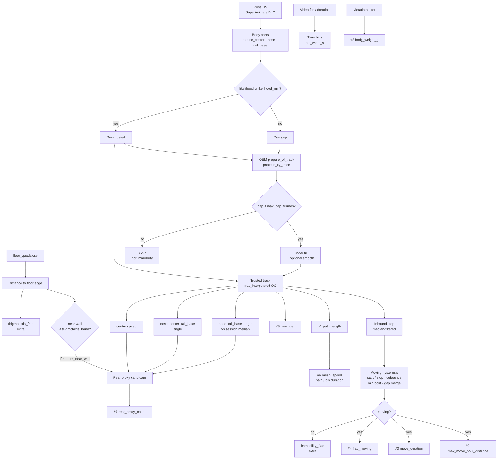

# INFO — Open-field Parks/Whitehead frailty metrics

**Living document.** Update this file whenever thresholds, gates, columns, or
overlay behavior change while dialing the metrics. Prefer editing the **Knobs**
table and the **Model** chart in the same change as the code defaults in
`maze.pipeline.open_field.features`.

| Field | Value |
|-------|-------|
| **Status** | Draft — seven video items (+ extras). Not a locked FI claim. |
| **Grain** | Time bin inside one video session (`bin_width_s`, default 600 s) |
| **Code** | `maze.pipeline.open_field.features` · `running_metrics` · CLI `maze-of-feature-table` · `maze-of-overlay-metrics` |
| **Units** | px / px·s⁻¹ / deg·px⁻¹ until `px_per_cm` is joined |
| **Lit map** | [rodent_frailty_index_features.md](../research/rodent_frailty_index_features.md) ([Parks 2012](https://doi.org/10.1093/gerona/glr193); [Whitehead 2014](https://doi.org/10.1093/gerona/glt136)) |
| **Rearing (next)** | [INFO_of_rear_classifier.md](INFO_of_rear_classifier.md) — MLP in [`of_rear_classifier/`](../../of_rear_classifier/) (not `maze.pipeline.open_field`); replaces proxy for Parks #7 |
| **Last dial-in note** | 2026-11-05 — rear gate: nose–center–tail_base angle ≥160° (replaced nose-speed); geometric proxy abandoned for FI — see rear-classifier INFO |

---

## Model (overview)



**Invariants**

- Unfilled low-likelihood gaps reset movement state and are never scored as immobility.
- Short gaps are filled with OEM `process_xy_trace` (linear, both flanks required) before kinematics; long gaps stay GAP.
- Moving uses OEM-style hysteresis (`start ≥ stop`), not a single speed cut.
- `rear_proxy_count` is a **top-view proxy**, not EthoVision Behavior Recognition (BR).
- Parks #7 stays off claims until a **Sturman-style rear classifier** is ported and
  validated ([INFO_of_rear_classifier.md](INFO_of_rear_classifier.md)); the geometric
  proxy is interim overlay dial-in only.

---

## Parks column map (feature CSV)

| Parks # | Column | Definition (this code) | Notes |
|--------:|--------|------------------------|-------|
| 1 | `path_length_px` | Sum of adjacent **trusted** `mouse_center` steps in the bin | Gaps do not contribute |
| 2 | `max_move_bout_distance_px` | Longest path inside one contiguous **moving** bout | After hysteresis + bout filters |
| 3 | `move_duration_s` | `#moving frames / fps` | |
| 4 | `frac_moving` | `move_duration_s / bin wall-clock` | Bin duration, not trusted-only |
| 5 | `meander_deg_per_px` | Σ\|Δheading\| (deg) / path length (px) | → deg/cm after scale |
| 6 | `mean_speed_px_s` | `path_length_px / bin duration` | Trial-average velocity |
| 7 | `rear_proxy_count` | Count of rear-proxy bouts | Not EthoVision BR |
| (later) | `body_weight_g` | Scale weight | Metadata; Parks #8 |
| extra | `mean_active_speed_px_s` | Mean center speed on moving frames | Convenience |
| extra | `immobility_frac` | Fraction of scored inbound-step frames not moving | Gaps excluded |
| extra | `thigmotaxis_frac` | Trusted frames with edge distance ≤ band | Not in Parks eight |
| QC | `frac_interpolated` | Fraction of bin frames gap-filled by OEM prep | Was raw-gap, now trusted |
| QC | `n_frames`, `n_trusted` | Bin frame counts (`n_trusted` after prep) | |
| keys | `video_id`, `bin_index`, `t0_s`, `t1_s`, `bin_width_s` | Identity / window | |

---

## Knobs (single table)

Defaults live in `maze.pipeline.open_field.features` (`DEFAULT_*`). CLI flags
match the names below (`--move-start-speed-px-s`, …). Keep this table in sync
when dialing.

| Group | Knob | Default | Keypoints | CLI / note | Controls |
|-------|------|--------:|-----------|------------|----------|
| QC | `likelihood_min` | 0.6 | `mouse_center`, `nose`, `tail_base` (each alone) | `--likelihood-min` | Raw trusted gate before OEM prep |
| Prep | `interpolate_gaps` | true | same three tracks, separately | `--no-interpolate-gaps` flips **off** | OEM short-gap linear fill |
| Prep | `max_gap_frames` | 15 | same three | `--max-gap-frames` | Max NaN run to fill |
| Prep | `trace_smooth` | true | same three | `--no-trace-smooth` flips **off** | OEM moving-average after fill |
| Prep | `trace_smooth_window` | 3 | same three | `--trace-smooth-window` | Smooth window (frames; ≥ 3) |
| Bin | `bin_width_s` | 600 | — | `--bin-width-s` | Feature-table grain (not overlay) |
| Move | `move_start_speed_px_s` | 8 | `mouse_center` inbound step | `--move-start-speed-px-s` | Enter-moving (px/s) |
| Move | `move_stop_speed_px_s` | 4 | `mouse_center` inbound step | `--move-stop-speed-px-s` | Exit-moving; start ≥ stop |
| Move | `move_entry_debounce_frames` | 3 | `mouse_center` | `--move-entry-debounce-frames` | Frames above start to enter |
| Move | `move_exit_debounce_frames` | 3 | `mouse_center` | `--move-exit-debounce-frames` | Frames below stop to exit |
| Move | `move_speed_median_window` | 3 | `mouse_center` step | `--move-speed-median-window` | Median filter before hysteresis |
| Move | `min_bout_frames` | 4 | `mouse_center` bouts | `--min-bout-frames` | Drop shorter move bouts |
| Move | `inter_bout_gap_frames` | 4 | `mouse_center` bouts | `--inter-bout-gap-frames` | Merge short gaps between bouts |
| Move | `immobile_speed_px_s` | — | `mouse_center` | `--immobile-speed-px-s` | Legacy stop; start=2×stop if start default |
| Rear | `rear_length_frac` | 0.75 | `nose`–`tail_base` length | `--rear-length-frac` | ≤ frac × session median length |
| Rear | `rear_max_speed_px_s` | 15 | `mouse_center` speed | `--rear-max-speed-px-s` | Max center speed while rear candidate |
| Rear | `rear_min_angle_deg` | 160 | `nose`, `mouse_center`, `tail_base` | `--rear-min-angle-deg` | Require open n–c–t angle (rejects curled grooming) |
| Rear | `rear_min_frames` | 3 | rear candidate stream | `--rear-min-frames` | Min contiguous frames → one count |
| Rear | `rear_require_near_wall` | true | `nose` (prefer) or nose–tail midpoint vs floor edges | `--rear-allow-center` flips **off** | Supported-rear / Wall-zone prior |
| Arena | `thigmotaxis_band_px` | 40 | `mouse_center` (thigmo%); `nose`/midpoint (rear wall) | `--thigmotaxis-band-px` | Near-wall band (px) |
| Arena | floor quad | — | arena geometry only | `--quad-csv` (+ `--allow-review`) | Wall gate + overlay outline |
| Overlay | `pcutoff` | 0.6 | **all drawn** SuperAnimal parts | `--pcutoff` | Draw gate only (metrics use `likelihood_min`) |
| Overlay | `max_frames` | — | — | `--max-frames` | Smoke length |

Metrics use only **`mouse_center`**, **`nose`**, and **`tail_base`**. Other SuperAnimal keypoints are drawn when above `pcutoff` but do not enter Parks scalars.

**Dial-in cheat sheet**

| If you see… | Twist |
|-------------|--------|
| Path breaks / MOVE flicker on blinks | keep interp on; ↑ `max_gap_frames` carefully |
| Invented chords across long hides | ↓ `max_gap_frames`; check `frac_interpolated` |
| MOVE flicker (real speed noise) | ↑ start, ↑ entry debounce, ↑ min-bout |
| MOVE stuck on | ↓ stop, ↑ exit debounce |
| Too many REAR ticks (esp. grooming) | ↓ `rear_length_frac`, ↓ both max speeds, ↑ `rear_min_frames`; ensure `--quad-csv` |
| No REAR when expected at wall | reverse rear knobs; check `rear_wall=on` in HUD |
| Center-field rears wanted | `--rear-allow-center` |

Retune move start/stop (and bands) after `px_per_cm` exists — cm/s gates should replace px/s.

---

## Rear proxy vs EthoVision

EthoVision XT **Behavior Recognition** scores **Grooming**, **Rearing
supported**, and **Rearing unsupported** as **separate learned classes** (not
via contour elongation). Supported rear needs a careful **Wall zone**; BR recall
is ~70% vs manual
([EthoVision XT 19 docs](https://noldus.com/shared/resources/book/noldus-product-documentation/chapter/ethovision-xt/page/ethovision-xt-19-behavior-recognition)).

Top-view **short body + low translation** confounds supported rear with
crouched grooming; we approximate the wall prior + quiet-nose gate. Parks papers
used EthoVision rearing frequency — not this proxy.

Overlay HUD: **left** = running Parks counters + `rear_wall=on|off|no_quad`
(state may show `INTERP` vs `GAP`). **Right** = live `center_v`,
`body_L/med` (`*` when ≤ `rear_length_frac`), `n-c-t ang` (`*` when ≥
`rear_min_angle_deg`). Without `--quad-csv`, wall prior is inactive (feature
table → 0 rears if wall required; overlay warns).

`body_L/med` remains a weak top-view rearing cue (kept as a gate for now);
angle is the anti-curl substitute for the old nose-speed gate. For the planned
MLP (Supported / Unsupported / Grooming / None) see
[INFO_of_rear_classifier.md](INFO_of_rear_classifier.md).

---

## Still missing for a locked FI

| Item | Role |
|------|------|
| `px_per_cm` | Convert distance / speed / meander / bands to cm |
| `body_weight_g` (+ strain, age) | Parks #8 + reference strata |
| Young-reference mean / SD | Deficit coding → 0–1 FI |
| Locked thresholds | Especially move speeds after scale |
| Rearing classifier | Port Sturman recipe; Davis labels; drop proxy from FI path |

---

## Artifact map

| Artifact | Producer |
|----------|----------|
| `*_features_*.csv` | `uv run maze-of-feature-table …` |
| `*_metrics*.mp4` | `uv run maze-of-overlay-metrics … --quad-csv …` |
| Floor quads | `maze-of-floor-quad` / `floor_quads.csv` |
| Pose H5 | SuperAnimal / DLC (`of_superanimal_infer`) |

### Feature table regen

```powershell
uv run maze-of-feature-table `
  --h5 "…\Test 27_….h5" `
  --video "…\Test 27.mp4" `
  --quad-csv "…\floor_quads.csv" `
  --out "…\Test 27_features_600s.csv" `
  --bin-width-s 600
```

### Overlay eyeball (wall gate on)

```powershell
uv run maze-of-overlay-metrics `
  --h5 "D:\Open Field - superanimal\Test 27_superanimal_topviewmouse_hrnet_w32_fasterrcnn_resnet50_fpn_v2.h5" `
  --video "D:\Open Field - mp4\Test 27.mp4" `
  --quad-csv "D:\DeepLabCut\of_frailty\floor_quads\floor_quads.csv" `
  --out "D:\Open Field - superanimal\Test 27_metrics_wall.mp4" `
  --max-frames 3000
```

### Overlay eyeball (stricter knobs example)

```powershell
uv run maze-of-overlay-metrics `
  --h5 "D:\Open Field - superanimal\Test 27_superanimal_topviewmouse_hrnet_w32_fasterrcnn_resnet50_fpn_v2.h5" `
  --video "D:\Open Field - mp4\Test 27.mp4" `
  --quad-csv "D:\DeepLabCut\of_frailty\floor_quads\floor_quads.csv" `
  --out "D:\Open Field - superanimal\Test 27_metrics_strict.mp4" `
  --max-frames 3000 `
  --move-start-speed-px-s 12 `
  --move-stop-speed-px-s 5 `
  --move-entry-debounce-frames 4 `
  --move-exit-debounce-frames 4 `
  --min-bout-frames 6 `
  --inter-bout-gap-frames 4 `
  --rear-length-frac 0.65 `
  --rear-max-speed-px-s 10 `
  --rear-min-angle-deg 160 `
  --rear-min-frames 5
```

---

## Verification

- Litmus / unit: `tests/test_open_field_features.py`, `tests/test_open_field_running_metrics.py`
(hysteresis spike/dip; rear wall + nose-jitter rejects; short-gap fill /
long-gap refuse; path reconnect).
- Overlay eye-check is **validation** support, not verification of Parks
equivalence.
- Helper: `prepare_of_track` → `maze.pipeline.tracking.trace_processing.process_xy_trace`.
