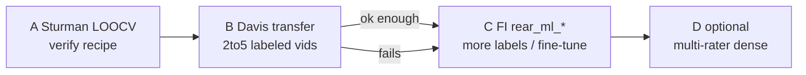
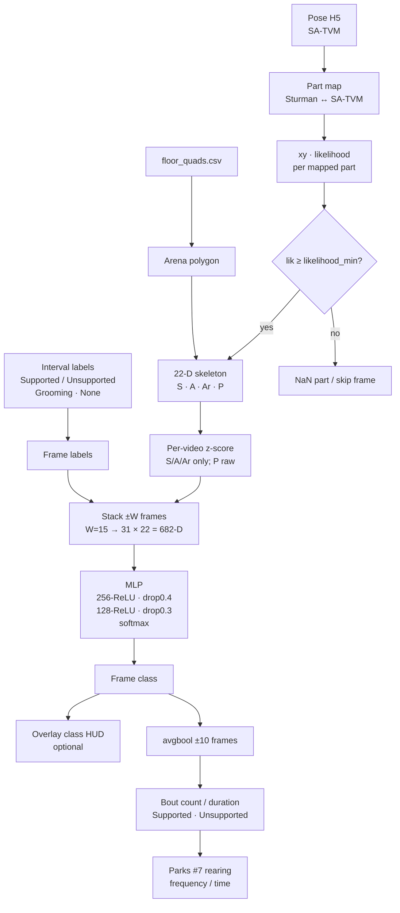

# INFO — Open-field rearing classifier (Sturman / SuperAnimal recipe)

**Living design doc.** Companion to
[INFO_of_frailty_metrics.md](INFO_of_frailty_metrics.md). Records **our** port of
the Sturman OFT (open-field test) rearing MLP (multi-layer perceptron) that the
SuperAnimal paper reused, mapped onto **SA-TVM** (SuperAnimal–TopViewMouse)
keypoints from this lab’s pose H5s.

| Field | Value |
|-------|-------|
| **Status** | Goal A ✓; Goals B–D open (see [Goals A–D](#goals-ad)) |
| **Code** | [`of_rear_classifier/`](../../of_rear_classifier/) (repo child; **not** under `maze/`). Thin allowlist: `maze.pipeline.open_field.dlc_h5` (+ floor-quad vertices for P1/P2). Sturman path uses local CSV loader (no maze). |
| **Replaces (for Parks #7)** | Geometric `rear_proxy_*` gates in `maze.pipeline.open_field.features` (kept only as interim overlay dial-in) |
| **Upstream recipe** | [ETHZ-INS/DLCAnalyzer](https://github.com/ETHZ-INS/DLCAnalyzer) `create_skeleton_v1` + `create_train_set_OFT` + keras MLP (`old_outdated_R/OLD_DLCAnalyzer_OFT_MachineLearning_final.R`) |
| **Paper echo** | Ye et al. SuperAnimal (Nat Commun): 22-D skeleton × 31-frame window → MLP (± CEBRA); figure kit [AdaptiveMotorControlLab/modelzoo-figures](https://github.com/AdaptiveMotorControlLab/modelzoo-figures) `figures/Figure4.ipynb` |
| **Labels (train seed)** | `DLCAnalyzer/data/OFT/Labels/AllLabDataOFT_final.csv` — Supported / Unsupported / Grooming (+ None gaps); annotators Jin / Furkan / Oliver |
| **Pose (this lab)** | SA-TVM H5 (`of_superanimal_infer`); bodyparts verified on `Test 27_…topviewmouse….h5` |
| **Last note** | 2026-11-06 — formalized Goals A–D; Goal A artifacts in `of_rear_classifier/runs/sturman_loocv/` |

**Abbreviations**

- **SA-TVM** — SuperAnimal–TopViewMouse Model Zoo pose model
- **OFT** — open-field test
- **MLP** — multi-layer perceptron (here: dense ReLU stack + softmax)
- **LOOCV** — leave-one-out cross-validation (here: leave-one-**video**)
- **CEBRA** — contrastive learning embedding used optionally in SuperAnimal Fig. 4 (not required for v1 port)
- **OEM** — OpenEthoMaze
- **FI** — frailty index (Parks/Whitehead)

**Question (plain):** Can we score Supported vs Unsupported rearing (and reject
Grooming / None) on top-view SA-TVM tracks with the Sturman skeleton→window→MLP
recipe?

**Grain (planned):** frame (classifier); bout after temporal smooth (Parks #7
count); optional time bin for feature tables (`bin_width_s`).

**What this is not:** not EthoVision Behavior Recognition; not unsupervised
syllable sequencing (kpMS) as the classifier itself (kpMS may later *assist*
labeling — Goal B/C); not the geometric `rear_proxy_count` gate; not a weights
file shipped inside DeepLabCut.

---

## Goals A–D

Ladder from recipe check → FI-usable rearing. Do not skip claim type.

| Goal | Name | Domain | New labels? | Done when | Claim type |
|------|------|--------|-------------|-----------|------------|
| **A** | Sturman LOOCV | Sturman OFT DLC + their intervals | **No** | Holdout frame/bout agreement vs Jin/Furkan/Oliver is sensible; artifacts + INFO table | **Verification** (code≡recipe) |
| **B** | Davis transfer sanity | Lab SA-TVM H5 + floor quads | **Yes — small** (~2–5 videos, bout intervals) | Sturman- or Goal-A-weights applied to Davis; overlay + labeled time look non-crazy vs human | **Validation** (domain check) |
| **C** | FI-usable Parks #7 | Lab frailty cohort | **Yes — more** (~10–20 sessions if B weak; ≥2 raters on a subset) | `rear_ml_*` columns locked; LOOCV/fine-tune on Davis; proxy dropped from FI path | **Validation** + FI metric |
| **D** | Sturman-grade protocol (optional) | Lab or mixed | Dense bout labels ~20 videos × multi-rater | Paper-like multi-annotator agreement protocol on our assay | Gold-standard labeling study |



| Goal | Needs from human | Needs from code |
|------|------------------|-----------------|
| A | — | ✓ `run_sturman_loocv.py` + `runs/sturman_loocv/` |
| B | Davis bout labels (Tests **10, 42**, scorer DOH) | SA features + `run_davis_transfer.py` ✓ — Sturman Jin/Furkan/Oliver → Davis; see `of_rear_classifier/runs/davis_transfer/` |
| C | Label budget + FI definition (Supported-only vs +Unsupported); second rater subset | Train/fine-tune on Davis; optional **all-raters pooled MLP** / light ensemble init; feature-table columns; retire proxy for FI |
| D | Multi-rater protocol + time | Same stack; agreement stats |

**kpMS note:** syllable start/stop is the **preferred Goal B labeling UX** (not frame scrubbing). Classifier input stays skeleton→window→MLP unless we change the recipe. Runbook: [`of_rear_classifier/docs/WEEKEND_KPMS.md`](../../of_rear_classifier/docs/WEEKEND_KPMS.md). Tools: `export_sa_for_kpms.py`, `label_syllable_bouts.py`.

---

## Model (overview)



**Invariants (design)**

- Classifier input is **skeleton geometry over a short window**, not raw xy and
  not the 3-part rear proxy.
- Continuous skeleton cols are **z-scored per video**; arena flags `P1`/`P2` are
  **not** z-scored.
- Default class outside labeled intervals is `None`.
- Bout metrics use a boolean smooth (`avgbool`, majority over ±10 frames) before
  counting transitions — same idea as Sturman post-process.
- Sturman LOOCV and annotator splits are for **recipe verification** on their
  data; Davis frailty OF needs **local labels** (or explicit transfer study)
  before FI claims.

---

## Relation to frailty metrics INFO

| Item | `INFO_of_frailty_metrics` | This doc |
|------|---------------------------|----------|
| Parks #7 | `rear_proxy_count` (geometric) | Planned `rear_ml_*` from MLP bouts |
| Keypoints used | `mouse_center`, `nose`, `tail_base` only | Full mapped skeleton (~14–16 parts) |
| Wall prior | `rear_require_near_wall` + floor quad | Optional; Sturman used `P1`/`P2` in-arena flags, not wall-band |
| Status | Implemented CLI / overlay | Design only |

When the MLP lands in `maze.pipeline.open_field`, update **both** INFOs in the
same change (columns, knobs, mermaid).

---

## SA-TVM part map (verified)

Source parts: Sturman DLCAnalyzer OFT network. Target parts: unique
`bodyparts` in
`Test 27_superanimal_topviewmouse_hrnet_w32_fasterrcnn_resnet50_fpn_v2.h5`
(27 names).

| Sturman | Role | SA-TVM (this lab) | Notes |
|---------|------|-------------------|-------|
| `nose` | snout | `nose` | exact |
| `headcentre` | head mid | `head_midpoint` | exact analogue |
| `neck` | neck | `neck` | exact |
| `bodycentre` | torso | `mouse_center` | OEM frailty center; alt `mid_back` |
| `bcl` | left flank | `left_midside` | exact analogue |
| `bcr` | right flank | `right_midside` | exact analogue |
| `hipl` | left hip | `left_hip` | exact |
| `hipr` | right hip | `right_hip` | exact |
| `earl` | left ear | `left_ear` | tip `left_ear_tip` unused in v1 |
| `earr` | right ear | `right_ear` | tip unused in v1 |
| `tailbase` | tail root | `tail_base` | exact |
| `tailcentre` | mid-tail | `tail2` | Sturman had one mid; SA has `tail1`…`tail5` — **`tail2` default** |
| `tailtip` | tip | `tail_end` | not `tail5` |

Unused SA-TVM for v1 recipe (available later): eyes, shoulders, extra spine
(`mid_backend*`), `tail1`/`tail3`–`tail5`, ear tips.

Arena corners in Sturman CSVs (`tl`/`tr`/`bl`/`br`) are **box corners**, not
animal parts — map to OEM `floor_quads.csv`, not keypoints.

---

## 22-D skeleton (per frame)

Faithful port of `create_skeleton_v1` /
`CreateSkeletonData_OFT`. Distance = Euclidean px. Angle = unsigned acos of
angle between vectors `(p1−p2)` and `(p3−p4)` (radians in Sturman; store either
rad or deg consistently). Area = shoelace absolute area/2 of the named polygon.

| ID | Type | Definition (SA-TVM names) |
|----|------|---------------------------|
| S1 | length | `nose`–`head_midpoint` |
| S2 | length | `head_midpoint`–`neck` |
| S3 | length | `neck`–`mouse_center` |
| S4 | length | `mouse_center`–`right_midside` |
| S5 | length | `mouse_center`–`left_midside` |
| S6 | length | `mouse_center`–`tail_base` |
| S7 | length | `tail_base`–`right_hip` |
| S8 | length | `tail_base`–`left_hip` |
| S9 | length | `tail_base`–`tail2` |
| S10 | length | `tail2`–`tail_end` |
| A1 | angle | `tail_base`→`tail2` vs `tail2`→`tail_end` |
| A2 | angle | `right_hip`→`tail_base` vs `tail_base`→`left_hip` |
| A3 | angle | `tail_base`→`mouse_center` vs `mouse_center`→`neck` |
| A4 | angle | `right_midside`→`mouse_center` vs `mouse_center`→`left_midside` |
| A5 | angle | `mouse_center`→`neck` vs `neck`→`head_midpoint` |
| A6 | angle | `tail_base`→`mouse_center` vs `neck`→`head_midpoint` |
| Ar1 | area | triangle `tail_base`, `right_hip`, `left_hip` |
| Ar2 | area | quad `right_hip`, `left_hip`, `left_midside`, `right_midside` |
| Ar3 | area | quad `right_midside`, `right_ear`, `left_ear`, `left_midside` |
| Ar4 | area | triangle `right_ear`, `nose`, `left_ear` |
| P1 | flag | `nose` inside floor-quad arena (0/1) |
| P2 | flag | `head_midpoint` inside floor-quad arena (0/1) |

**Z-score:** for each video, `(x − mean) / sd` on S1–S10, A1–A6, Ar1–Ar4;
leave P1, P2 unchanged (`ZScore_normalize_skeleton_v1`).

**Later variants (not v1):** DLCAnalyzer `_v2` adds per-point accelerations;
`_v3` adds distance-to-wall. SuperAnimal Fig. 4 optional CEBRA on the window
vector. Defer until base MLP is verified.

---

## Temporal window

Sturman OFT ML: `integration_window = 15` at `fps = 25` → about 1.24 s context.

| Knob | Sturman | Our default (planned) |
|------|--------:|----------------------:|
| `W` / `integration_window` | 15 | 15 (rescale if fps ≠ 25: aim ~0.6 s half-width) |
| Copies stacked | 31 (= 2W+1) | 31 centered |
| Input width | 22 × 31 = **682** | same if all 22 features kept |
| Label alignment | frame `t` → window centered near `t` | use **centered** ±W (cleaner than R `cbind` off-by-ones; same intent) |

Python shape:

```python
# F: (T, 22) after per-video z-score
# y: (T,) string labels; intervals → frames; else "None"
W = 15
X = np.stack([F[t - W : t + W + 1].ravel() for t in range(W, T - W)])  # (T-2W, 682)
y_win = y[W : T - W]
```

---

## MLP + training protocol

| Piece | Sturman OFT script | Our port |
|-------|--------------------|----------|
| Architecture | Dense 256-ReLU → Dropout 0.4 → Dense 128-ReLU → Dropout 0.3 → Softmax | same |
| Loss / opt | categorical cross-entropy, RMSprop | same or Adam (note if changed) |
| Epochs / batch | 10 / 32 | start same |
| Classes | Supported, Unsupported, Grooming, None | same four |
| CV | LOOCV by video × per annotator | (1) reproduce on DLCAnalyzer OFT; (2) LOOCV on Davis labels |
| Stack | R + keras/TF | **Python** (PyTorch or TF/keras) inside OEM — do not depend on R runtime |

**Post-process (bout readout):** `avgbool(pred == class, window=10)` then count
onsets / sum time — mirrors Sturman `Supported_*` / `Unsupported_*` columns.

---

## Planned columns (when implemented)

| Column | Grain | Meaning |
|--------|-------|---------|
| `rear_ml_supported_count` | bin or session | Supported bouts after smooth |
| `rear_ml_unsupported_count` | bin or session | Unsupported bouts after smooth |
| `rear_ml_supported_s` | bin or session | Supported time (s) |
| `rear_ml_unsupported_s` | bin or session | Unsupported time (s) |
| `rear_ml_grooming_s` | optional | Grooming time if class kept |
| QC | `rear_ml_frac_none`, `frac_low_lik_skeleton` | Coverage |

Parks #7 historically is rearing **frequency**; decide Supported-only vs
Supported+Unsupported sum when locking FI (document here when chosen).

---

## Knobs (planned)

| Group | Knob | Default | Notes |
|-------|------|--------:|-------|
| QC | `likelihood_min` | 0.6 | Per mapped part before geometry |
| Skeleton | `tail_mid_part` | `tail2` | Alternate `tail1`/`tail3` if mid drifts |
| Skeleton | `body_part` | `mouse_center` | Alternate `mid_back` |
| Window | `integration_window` | 15 | Frames half-width; scale with fps |
| Train | `epochs`, `batch_size`, dropouts | 10, 32, 0.4/0.3 | Match Sturman until ablations |
| Bout | `avgbool_window` | 10 | Post-class smooth |
| Arena | floor quad | required for P1/P2 | Same `floor_quads.csv` as frailty metrics |
| Optional | `cebra` | off | Fig. 4 path only |

---

## Sources & paths

| Asset | Path / URL |
|-------|------------|
| Sturman functions | `C:\Users\admin\code\DLCAnalyzer\R\DLCAnalyzer_Functions_final.R` (`CreateSkeletonData_OFT`, `CreateTrainingSet`) |
| Sturman OFT ML script | `C:\Users\admin\code\DLCAnalyzer\old_outdated_R\OLD_DLCAnalyzer_OFT_MachineLearning_final.R` |
| Skeleton v1 (paper-era) | `C:\Users\admin\code\DLCAnalyzer\old_outdated_R\OLD_DLCAnalyzer_Functions_final.R` (`create_skeleton_v1`, `create_train_set_OFT`) |
| OFT labels | `C:\Users\admin\code\DLCAnalyzer\data\OFT\Labels\AllLabDataOFT_final.csv` |
| OFT DLC CSVs | `C:\Users\admin\code\DLCAnalyzer\data\OFT\Output_DLC\` |
| SuperAnimal Fig. 4 | https://github.com/AdaptiveMotorControlLab/modelzoo-figures |
| Frailty metrics (proxy) | [INFO_of_frailty_metrics.md](INFO_of_frailty_metrics.md) |
| Lab pose example | `D:\Open Field - superanimal\Test 27_superanimal_topviewmouse_….h5` |

---

## Goal A — Sturman LOOCV (verified run)

**Question:** does our Python recipe recover sensible holdout agreement with each
Sturman annotator on their OFT DLC CSVs?

| | |
|--|--|
| **Runner** | `uv run --extra sleap python of_rear_classifier/scripts/run_sturman_loocv.py` |
| **Artifacts** | [`of_rear_classifier/runs/sturman_loocv/`](../../of_rear_classifier/runs/sturman_loocv/) `fold_metrics.csv`, `summary.json` |
| **Generated** | 2026-11-06 |
| **Folds** | 60 = 20 videos × {Jin, Furkan, Oliver} |
| **Train knobs** | epochs=10, batch=256, W=15, cut±100 frames, lik≥0.95; **None** capped at 2× behavior frames (≤80k train rows/fold) — speed/balance vs raw Sturman R (batch 32, full None) |

### Holdout frame accuracy (mean)

| Annotator | mean frame acc |
|-----------|---------------:|
| Furkan | 0.854 |
| Jin | 0.853 |
| Oliver | 0.851 |
| **All folds** | **0.853** |

### Bout-level Spearman ρ (pred vs that annotator, after avgbool±10)

| Annotator | Supported time | Unsupported time | Supported count | Unsupported count |
|-----------|---------------:|-----------------:|----------------:|------------------:|
| Furkan | 0.901 | 0.789 | 0.886 | 0.812 |
| Jin | 0.821 | 0.757 | 0.867 | 0.785 |
| Oliver | 0.847 | 0.764 | 0.891 | 0.826 |
| pooled folds | 0.873 | 0.774 | — | — |

**Claim type:** verification (code≡recipe on Sturman domain), **not** Davis
validation and **not** Parks FI lock.

---

## Goal B — Davis transfer (2026-11-09)

Train each Sturman annotator MLP on **all** OFT videos; apply to Davis SA-TVM
Tests **10** + **42** vs scorer **DOH** interval labels.

Command: `uv run --extra sleap python of_rear_classifier/scripts/run_davis_transfer.py`

Artifacts: `of_rear_classifier/runs/davis_transfer/` (`transfer_metrics.csv`,
`summary.json`, per-video `pred_*.csv`).

### Frame accuracy on DOH-covered frames (mean)

| Source model | Test 10 | Test 42 | mean |
|--------------|--------:|--------:|-----:|
| Furkan | 0.451 | 0.502 | **0.476** |
| Jin | 0.359 | 0.470 | 0.414 |
| Oliver | 0.351 | 0.455 | 0.403 |
| **All** | | | **0.431** |

Sturman in-domain LOOCV was ~0.85 — **zero-shot Davis transfer is weak**
(~chance-to-modest). Furkan is least bad; Supported *time* for Furkan on
Test 42 is close (pred 187 s vs DOH 190 s) but counts/frame labels still drift.

**HITL strip (a):** hard **majority vote** over Jin/Furkan/Oliver frame preds
→ `pred_<video>_majority.csv` (`mlp_ensemble.py`); labeler auto-loads majority
first. Cohort predict: `--videos all` (labels optional). Tie-break → Furkan.

**Goal C init (b, later):** one **all-raters pooled** Sturman MLP and/or light
softmax ensemble as fine-tune init — not required for HITL labeling.

**Claim type:** validation (domain check) — transfer alone is **not** enough
for FI `rear_ml_*`; expect Goal C fine-tune / train-on-Davis.

---

## Still missing before Parks #7 lock

| Item | Goal | Role |
|------|------|------|
| ~~Davis bout labels (small)~~ | B | ✓ Tests 10+42 DOH; transfer scored |
| Davis bout labels (cohort) + FI definition | C | FI-usable `rear_ml_*` |
| Drop geometric `rear_proxy_*` from FI path | C | Avoid two competing #7s |
| Multi-rater dense protocol | D | Optional gold standard |

---

## Verification

- **Litmus (Goal A):** Sturman LOOCV above — Supported/Unsupported time Spearman
  ≈ 0.75–0.90 vs matching annotator.
- **Metamorphic (unit):** `of_rear_classifier/tests` — feature dim, z-score P
  flags, centered window 682-D, toy angles.
- **Validation (Goal B):** Sturman→Davis frame acc ~0.43 vs DOH (Furkan ~0.48);
  not FI-ready.

Overlay eye-check remains **validation** support only.
