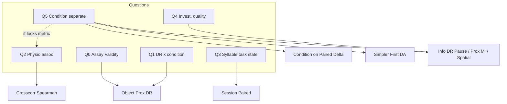

# NOR IMPRESS — experiment & analysis overview

**Purpose:** one curtailed map of the DARPA IMPRESS novel object recognition (NOR) experiment and the analyses that try to answer its clinically relevant questions. Nouns follow [CONTEXT.md](CONTEXT.md), [STATS.md](STATS.md), [PROTOCOL-STRATA.md](PROTOCOL-STRATA.md), [INTERPRET.md](INTERPRET.md). Boss day tokens: [NOR-IMPRESS-BOSS-SESSION-MAP.md](NOR-IMPRESS-BOSS-SESSION-MAP.md). Per-run dictionaries stay next to artifacts as `INFO_<tag>.md` (data-dictionary skill), not here.

**Obsidian claim graph (in-repo vault):** open `docs/vaults/nor-impress/` as a vault → hubs [[NOR IMPRESS Index]] (IMPRESS NOR) and [[VAST Alz Index]] (parallel VAST Alz / Gerstner paramscan). Graph colors: questions vs runs vs prune vs hubs.

**Lab analysis priority (not Boss headline):** (1) **condition-separating behavior with a recognition link** — primary; engagement Δ is a non-recog side claim (`Q5 Honesty Pass`). (2) **physio correlation** — follow-up only after (1) locks a metric (`Q2`; DR×physio already negative; engagement×physio null in males). (3) Q4 / joins as tools for (1). ARRIVE deferred.

**Status:** living claim map, not a manuscript Methods section. This file answers *what we asked* and *which artifacts speak*.

**Campaign roots (analysis art):**

| Campaign | Path |
|----------|------|
| Full ladder (21 models) | `sack/datas/impress/moseq_251017/_nor_object_mi/` |
| Recognition-only kpMS (9 models) | `sack/datas/impress/moseq_recog_260915/anatomical/_nor_object_mi/` |
| Behavior × physio Spearman | `sack/crosscorr/` |
| NOR geometry H5 | `sack/datas/impress/my_NOR_results.h5` |

Wire strata: `session` ∈ {`NOR_BL`, `NOR_TX`, `NOR_REC3hr`, `NOR_REC11hr`}; `trial` ∈ {`no_obj`, `id_obj`, `nvl_obj`}; `condition` ∈ {`noSD`, `GHSD`, `RBSD`}. Do not use boss `NOR1`…`NOR4` or `tx` as live column names.

---

## 1. What is the experiment?

**Plain:** rodents perform NOR across protocol days while assigned to a sleep-deprivation (SD) arm; separate PSG / physio summaries exist for the same animals. Lab story order: find a **condition-separating** behavior (prefer recognition-linked); **then** ask whether that metric tracks physio. Classic sold readout remains novel preference (DR).

**Design strip (name before any test):**

| Axis | Role |
|------|------|
| Within-animal protocol ladder | `session` → `trial` → (optional `interval`) |
| Between-animal strata | `condition`, `sex`, (audit) `cohort` |
| Recognition trial | `nvl_obj` after `id_obj` familiarization (and usually `no_obj` acclimation) |
| Primary classic scalar | discrimination ratio (DR) on `nvl_obj` |

**Sessions (prose gloss only):** baseline (`NOR_BL`) → challenge (`NOR_TX`) → recovery (`NOR_REC3hr` / `NOR_REC11hr`, cohort-dependent). Challenge is when condition arms are “on”; recovery tests whether effects wash out.

**Condition arms:** `noSD` (control), `GHSD` (gentle-handling SD), `RBSD` (rotary-bar SD). Intensity / method differ; both are SD relative to `noSD`.

**Two clocks in the analysis stack:**

1. **Classic / proximity occupancy** — investigation-time or object-prox gates → DR, `frac_near_*`.
2. **kpMS syllables** — keypoint-MoSeq label sequences → syllable composition, differential abundance (DA), mutual information (MI) with loci, cluster frame share.

Syllable work does **not** replace DR unless a syllable-derived score is explicitly defined as preference or investigation quality.

---

## 2. What should we expect in control (literature posture)?

Keep citations in Methods / lit notes; here is the **claim posture** only.

| Claim | Typical lit posture | What would falsify assay validity |
|-------|---------------------|-----------------------------------|
| Intact NOR at recognition | Unimpaired animals show **novel preference** (DR > 0, or more time / closer to novel) after a delay | `noSD` DR ≈ 0 or familiar preference at `NOR_TX` `nvl_obj` |
| SD impairs consolidation / recognition | Many SD protocols **reduce** novel preference when deprivation hits encoding or consolidation windows | (hypothesis, not assay validity) null DR×condition |
| Locomotor confounds | SD can change activity / arousal; occupancy-only metrics can move without “memory” | DR intact while speed / still change |

**Assay validity** = control (`noSD`, and often pooled) shows novel preference at the recognition session. **Efficacy of SD on memory** = condition changes that preference (or a pre-registered substitute). Do not conflate the two.

---

## 3. What do we see in control? (computed; cite INFO files)

Primary DR pack: `simpler_first_object_prox_0p10/` (`INFO_object_prox.md`). Consensus median DR across 21 models; exclusive DR (windows do not overlap in that run).

| Session | Preference (DR vs 0, sex=all, condition arms pooled) | Median DR (approx.) |
|---------|------------------------------------------------------|---------------------|
| `NOR_BL` | hit | ~0.17 |
| `NOR_TX` | strong hit | ~0.47 |
| `NOR_REC3hr` | weak / sex-dependent | ~0.11 |
| `NOR_REC11hr` | miss (near 0) | ~−0.05 |

**Read:** the assay works at challenge — animals prefer novel on `nvl_obj`. Baseline already shows mild preference; challenge sharpens it; late recovery loses the preference signal (protocol / delay / re-test story — not automatically “amnesia”).

Protocol prologue (mean/interval cousins): `simpler_first_protocol_prologue/` — same preference story with t-tests; condition coda is Welch ANOVA, not the rank primary.

---

## 4. How do condition arms compare?

**On the sold metric (DR at `NOR_TX`):** Kruskal–Wallis on `dr_exclusive` within sex — **miss** (F: p≈0.34; M: p≈0.96). Medians stay high in all arms (roughly 0.35–0.51). Same pattern for inclusive DR.

**Honest one-liner:** we do **not** have evidence that GHSD or RBSD shift novel preference relative to noSD on this DR definition. That is a **null on condition for DR**, not proof that memory circuits are untouched — only that this scalar did not separate arms.

Companion occupancy Kruskal cells (e.g. male `frac_near_nvl` at `NOR_TX`) can hit while DR does not — prefer novel *share* vs absolute near-novel time are different claims ([INTERPRET.md](INTERPRET.md)).

**Session shifts (often significant; different question):** `simpler_first_session_paired/` — within-animal Δ across sessions (e.g. BL→TX): `frac_near` ↑, `mean_dist_any` ↓, DR ↑ at TX. That is **protocol dynamics / engagement**, not “SD broke recognition.” Sell as: *how the NOR day sequence moves occupancy*, then optionally ask whether **Δ** is modulated by condition (difference-of-differences / Kruskal on Δ by condition — STATS paired-change vs tx modulation).

---

## 5. Clinical-relevant questions vs what we actually tested

| Priority | Plain question | Status | Vault note / anchors |
|----------|----------------|--------|----------------------|
| Q0 | Does NOR work in this cohort? | Answered (yes at TX) | object_prox, protocol_prologue, classic_dr |
| Q1 | Does SD change novel preference (DR)? | Answered (null at TX) | object_prox Kruskal |
| **Q5** | What feature separates `condition` arms (prefer recognition-linked)? | **#1 hunt.** Side claim: M engagement Δ. Recog + next candidates **fail** (DR / novelty / occupancy BH / spatial D-only / Q4); need new scores | vault `Q5 Honesty Pass` + Recognition + Candidates |
| **Q2** | Does **that locked** behavior track physio? | **#2.** DR×physio kill; engagement×physio **M null** | vault `Q2 Honesty Pass` + `Q2 Engagement Physio Honesty Pass` |
| Q3 | Syllable task-state across ladder? | Charted; easy to oversell | session_paired, presence_steps, DA |
| Q4 | Investigation quality beyond DR? | Not locked | info_dr_pause, prox MI, spatial; needs definition |

**Honesty gate (Q2 / Q5 / joins):** declare grain + family + hit rule before fishing; report ρ or median Δ + n; do not rename locomotion as memory. Syllable × DR / fam–nvl prox / quadrant scores help **only if** they pass that gate.

---

## 6. Syllable analysis — clearer story (and why it feels muddy)

Think of three **layers**, not one blob:

```text
Layer A — Instrument check
  Syllable bouts vs threshold+debounce movement bouts
  → same rough information about “when moving”
  Runs: syll_ambulation_overlap, ambulation_clocks, segmenter_pearson, protocol bout clocks
  Status: useful V&V; does NOT answer memory or physio

Layer B — Task-state composition
  Syllable composition / DA / cluster frame share across session × trial
  → “behavior vocabulary shifts when objects appear or across BL→TX→REC”
  Runs: presence_steps, session_paired, da, nested_da, slides_pack (Shannon/richness/BC/clusters/…), spatial heatmaps
  Status: rich D + I; easy to over-sell as “memory”

Layer C — Preference / quality / physio bridge
  Link syllable features to fam vs nvl, or to PSG
  → investigation quality score; syllable × physio Spearman
  Runs: info_dr_pause*, nearest_prox_mi*, moseq-physio / cluster*-physio crosscorr
  Status: where the clinical story must live — still under-specified
```

**Why muddy:** Layer B lights up (session shifts, some condition×cluster Kruskal cells) while Layer C has no locked primary. Boss “investigation quality” is Layer C without a definition that is (a) not DR in disguise, (b) not total locomotion, (c) tested against physio or a behavioral oracle.

**Honest report (motion sequencing only):** [`docs/vaults/openethomaze/assays/nor-impress/Motion Sequencing Honest Report.md`](../vaults/openethomaze/assays/nor-impress/Motion%20Sequencing%20Honest%20Report.md) — Layer A concordance (expected collinearity with threshold+debounce), composition rediscovery without a recognition lock, and sequence/n-gram nulls. Mini-poster sibling to the hunt PPTX. Not a full Q0–Q5 rebuild.

**ADR-0005 reminder:** `raw_syllable_id` is model-local. Cross-model / cross-animal equating is by **kinematic (+ proximity) signatures**, not integer ids ([adr/0005-syllable-kinematic-signature-not-raw-id.md](../adr/0005-syllable-kinematic-signature-not-raw-id.md)).

---

## 7. Claim → artifact graph

**Source of truth for graph links:** in-repo vault `docs/vaults/nor-impress/` (Obsidian Graph on that folder). Prune opinion: vault note `Prune Map`.



---

## 8. Per-animal kpMS + remapping — thoughts & concerns

**Motivation (yours):** pooled fits may smear within-animal “accent”; animal-specific alphabets + kinematic clustering might clarify Layer C.

**Aligned with ADR-0005:** remapping by kinematics is the right *kind* of equating. Per-animal fit is an extreme of “model-local ids.”

**Concerns (do before scaling):**

1. **Data poverty** — one animal’s frames may not stabilize a kpMS alphabet; expect brittle syllables and empty states.
2. **Degrees of freedom** — N alphabets × remapping hyperparameters can fit noise; pre-register remapping features and a holdout (e.g. leave-session-out).
3. **Quality score still undefined** — per-animal fit does not create a preference or physio link by itself. Define the score first (candidates: pause structure near novel, bout duration near novel, syllable entropy in prox window, approach–investigate–leave grammar), then ask whether animal-specific models improve that score’s reliability.
4. **Null DR×condition may be real** — if preference is intact under these SD arms, better segmentation will not invent a DR effect. Hunt other **recognition-linked** separators (Q5), then physio (Q2) — not endless DR re-cuts or physio fishing first.
5. **Sell session shifts correctly** — BL→TX occupancy / DR rise is consistent with a working recognition day, not with SD efficacy. Condition modulation of **Δ** is the interaction claim; raw session change is not.

**Suggested order:** lock Q4 definition → litmus (e.g. correlates with classic investigation time or DR residuals) → then per-animal fit only if pooled models fail that litmus for identifiable accent reasons.

---

## 9. ARRIVE soft checklist (overview vs Methods)

| ARRIVE item | This overview | Needs Methods fill-in |
|-------------|---------------|------------------------|
| Study design / groups | condition × sex; NOR ladder | exact n, cohorts, exclusions |
| Experimental unit | animal (paired analyses: animal×step) | confirm |
| Outcomes | DR primary sold; physio secondary hope | lock primary / secondary |
| Stats | Wilcoxon / Kruskal / Spearman / FDR families named in INFO files | software, family declarations |
| Procedures | point to boss map + cage/SD SOPs | ethics, randomisation, blinding |

Do not paste ARRIVE prose into INFO run dictionaries; keep Methods separate.

---

## 10. Next concrete steps

1. Open `docs/vaults/nor-impress/`; Graph + honesty passes.
2. **#1:** recognition + candidate honesty passes both fail (`Q5 Recognition` / `Q5 Candidates`); next needs **new** scores (quadrant / bout grammar). Engagement slides remain the non-recog side claim.
3. **#2:** only after a lock — physio × that metric (declared family).
4. ARRIVE Methods draft: deferred.

---

## Related

- [PROTOCOL-STRATA.md](PROTOCOL-STRATA.md)
- [NOR-IMPRESS-BOSS-SESSION-MAP.md](NOR-IMPRESS-BOSS-SESSION-MAP.md)
- [CONTEXT.md](CONTEXT.md) · [STATS.md](STATS.md) · [INTERPRET.md](INTERPRET.md) · [FORMULAS.md](FORMULAS.md)
- Sack campaign note: `moseq_recog_260915/.../CAMPAIGN.md`
- Crosscorr: `sack/crosscorr/README.md`
